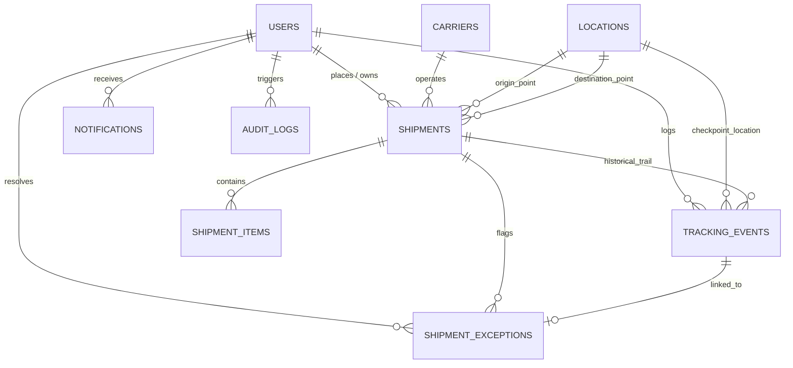

# CargoTrace — Global Shipment Visibility & Tracking Platform

[](https://laravel.com)
[](https://php.net)
[](https://mysql.com)
[](https://tailwindcss.com)
[](https://leafletjs.com)
[](https://phpunit.de)

> **Web Programming 2 — Final Project (UAS) Portfolio Submission**  
> *A production-grade, software-engineering-centric logistics platform built to demonstrate real-world architecture, deterministic business logic, spatial mapping, external API resilience, and role-based API security.*

---

## 📌 Executive Summary & Problem Domain

Global logistics suffers from opaque supply chains, distributed checkpoint fragmentation, and untimely notification of operational exceptions (such as customs holds, typhoons, and port congestion). 

**CargoTrace** addresses these issues by delivering:
1. **Strict Finite State Machine (FSM)**: Enforces business rules for status transitions (`CREATED` &rarr; `BOOKED` &rarr; `PICKED_UP` &rarr; `IN_TRANSIT` &rarr; `DELIVERED`). Terminal states (`DELIVERED`, `CANCELLED`) are immutable.
2. **Deterministic ETA & Delay Engine**: Dynamically shifts schedules when exceptions are flagged, computing delay hours and categorizing deviations into deterministic tiers (`LOW`: 0–6h, `MEDIUM`: 7–24h, `HIGH`: >24h).
3. **Interactive Spatial Map**: Integrates **Leaflet.js** and **OpenStreetMap** with custom polyline routes and waypoint markers.
4. **Resilient Weather Telemetry**: Queries **Open-Meteo REST API** for real-time wind speeds, temperatures, and meteorological hazard advisories with automated offline fallback.
5. **Full REST API Suite & Role Authorization**: Built with **Laravel Sanctum**, providing secure, server-validated access separated across `Administrator`, `Logistics Operator`, and `Customer` roles.

---

## 🏗️ System Architecture & Engineering Principles

CargoTrace strictly decouples HTTP transport controllers from domain business rules through a dedicated **Service Layer Architecture** (Slide 15):

```
┌────────────────────────────────────────────────────────┐
│               HTTP Requests & Web Clients              │
└───────────────────────────┬────────────────────────────┘
                            │
               ┌────────────▼────────────┐
               │  Routes & Middleware    │ (Sanctum, RoleGuard)
               └────────────┬────────────┘
                            │
               ┌────────────▼────────────┐
               │    Http Controllers     │ (Web & API Controllers)
               └────────────┬────────────┘
                            │
         ┌──────────────────┴──────────────────┐
         │            Service Layer            │
         │  ┌───────────────────────────────┐  │
         │  │ ShipmentService               │  │
         │  │ TrackingService               │  │
         │  │ EtaService                    │  │
         │  │ ExceptionService              │  │
         │  │ ExternalWeatherService        │  │
         │  │ AuditLogService               │  │
         │  └───────────────────────────────┘  │
         └──────────────────┬──────────────────┘
                            │
         ┌──────────────────┴──────────────────┐
         │          Eloquent & Data            │
         │  • MySQL / MariaDB Database         │
         │  • External Open-Meteo API          │
         └─────────────────────────────────────┘
```

---

## 🗄️ Database Design & Entity Relationship Diagram (ERD)

The data model encompasses 9 core entities fulfilling all mandatory brief specifications (Slide 11):



### Data Dictionary Summary
- **`users`**: User identities with roles (`admin`, `operator`, `customer`), hashed credentials, corporate metadata.
- **`carriers`**: Freight carriers (`MSK`, `DHL`, `ONE`, `HAPAG`) with transport modes (`SEA_FREIGHT`, `AIR_FREIGHT`, `ROAD_FREIGHT`, `MULTIMODAL`).
- **`locations`**: Global ports and distribution hubs with coordinates (`latitude`, `longitude`), UN/LOCODE, and city/country.
- **`shipments`**: Master consignments with tracking code (`shipment_number`), departure/arrival schedules, gross weight/volume, and calculated delay metrics.
- **`shipment_items`**: Individual cargo lines with Harmonized Tariff System (`hs_code`), weight, and quantities.
- **`tracking_events`**: Immutable chronological checkpoints with timestamps, spatial coordinates, and operator narratives.
- **`shipment_exceptions`**: Incidents (`CUSTOMS_HOLD`, `WEATHER_DELAY`, `PORT_CONGESTION`, etc.) with severity, resolution states, and delay impact.
- **`notifications`**: In-app push notifications for status updates and incident alerts.
- **`audit_logs`**: Tamper-evident governance trail tracking actor, action, mutated entity, and JSON change diffs.

---

## ⚡ Deterministic Business Rules

### 1. Shipment Status Transition Matrix (Slide 6)
```
[CREATED] ──► [BOOKED] ──► [PICKED_UP] ──► [IN_TRANSIT] ──► [DELIVERED] (Terminal)
    │             │
    └──► [CANCEL] └──► [CANCEL] (Terminal)
```
- A shipment cannot skip lifecycle stages (e.g. `CREATED` directly to `DELIVERED` is rejected with HTTP 422).
- Terminal statuses (`DELIVERED`, `CANCELLED`) cannot transition backwards without administrator override.

### 2. ETA & Delay Calculation Formula (Slide 8)
$$\Delta T = \text{EstimatedArrival} - \text{ExpectedArrival}$$
- $\Delta T \le 0$: On Schedule (`is_delayed = false`, `severity = NONE`)
- $0 < \Delta T \le 6\text{ hours}$: `LOW` severity
- $6 < \Delta T \le 24\text{ hours}$: `MEDIUM` severity
- $\Delta T > 24\text{ hours}$: `HIGH` severity
- When an incident is logged with $\text{impact\_hours}$, dynamic ETA shifts forward:
$$\text{ETA}_{\text{new}} = \text{ETA}_{\text{prev}} + \text{impact\_hours}$$

---

## 🔑 Demo Accounts (Slide 18 & 19)

CargoTrace includes an **Instant Evaluator 1-Click Login Toolbar** on both the Home Page and Login Page. You can also log in manually with the following seeded accounts:

| Role | Email Address | Password | Permissions |
| :--- | :--- | :--- | :--- |
| **Administrator** | `admin@cargotrace.test` | `password` | Complete access, master carriers & locations, user management, audit logs, shipment deletion. |
| **Logistics Operator** | `operator@cargotrace.test` | `password` | Register shipments, log tracking checkpoints, flag & resolve exceptions, operational dashboard. |
| **Customer** | `customer@cargotrace.test` | `password` | View only assigned shipments, timeline tracking, map view, receive alerts. |

---

## 🚀 Installation & Local Setup

### Prerequisites
- **PHP 8.2 or 8.3+** with extensions: `pdo_mysql`, `curl`, `mbstring`, `openssl`, `zip`, `fileinfo`
- **Composer 2.x**
- **MySQL 8.0+** or **MariaDB 10.4+** (e.g. XAMPP)

### Step-by-Step Setup

1. **Navigate to the workspace**:
   ```bash
   cd "C:\xampp\htdocs\project uas"
   ```

2. **Configure Environment Variables**:
   Copy `.env.example` to `.env` (already pre-configured for local MySQL/MariaDB):
   ```ini
   APP_NAME="CargoTrace"
   DB_CONNECTION=mysql
   DB_HOST=127.0.0.1
   DB_PORT=3306
   DB_DATABASE=cargotrace
   DB_USERNAME=root
   DB_PASSWORD=
   DELAY_THRESHOLD_HOURS=18
   CARGOTRACE_WEATHER_API_URL=https://api.open-meteo.com/v1/forecast
   ```

3. **Install Dependencies & Key Generation** (if cloning clean):
   ```bash
   composer install
   php artisan key:generate
   ```

4. **Run Migrations & Rich Seed Data**:
   ```bash
   php artisan migrate:fresh --seed
   ```

5. **Start Local Development Server**:
   ```bash
   php artisan serve
   ```
   Open your browser at **[http://localhost:8000](http://localhost:8000)**.

---

## 🧪 Automated Testing Suite (Slide 16)

The project includes an automated PHPUnit / Pest test suite verifying authentication, lifecycle validation, deterministic delay rules, role permissions, and REST API contracts:

```bash
php artisan test
```

### Verified Test Summary (16 Tests, 50 Assertions — 100% Pass):
- `AuthenticationTest`:
  - `test_user_can_login_via_web` (Pass)
  - `test_invalid_login_is_rejected` (Pass)
  - `test_api_login_returns_sanctum_token` (Pass)
  - `test_unauthenticated_request_to_api_is_unauthorized` (Pass)
- `ShipmentLifecycleTest`:
  - `test_valid_shipment_lifecycle_progression` (Pass)
  - `test_illegal_status_transition_is_rejected` (Pass)
  - `test_terminal_status_cannot_be_reverted` (Pass)
- `EtaDelayEvaluationTest`:
  - `test_nominal_schedule_is_not_delayed` (Pass)
  - `test_delay_severity_thresholds_match_rubric` (Pass)
  - `test_exception_impact_updates_shipment_delay` (Pass)
- `ShipmentApiAndAuthorizationTest`:
  - `test_customer_can_only_view_own_shipment` (Pass)
  - `test_customer_cannot_create_shipment_via_api` (Pass)
  - `test_operator_can_create_shipment_via_api` (Pass)
  - `test_public_tracking_endpoint_is_accessible_without_auth` (Pass)

---

## 📡 REST API & Postman Collection (Slide 12 & 13)

The project contains a pre-built Postman collection: **[`CargoTrace.postman_collection.json`](file:///C:/xampp/htdocs/project%20uas/CargoTrace.postman_collection.json)**. Import this JSON file directly into Postman to explore all endpoints.

### API Endpoints Summary

| Method | Endpoint | Description | Auth Required |
| :--- | :--- | :--- | :--- |
| `POST` | `/api/register` | Register new customer account | No |
| `POST` | `/api/login` | Authenticate & acquire Sanctum Bearer token | No |
| `POST` | `/api/logout` | Revoke active API token | Bearer Token |
| `GET` | `/api/user` | Get authenticated user profile | Bearer Token |
| `GET` | `/api/public/track/{number}` | Public consignment lookup by tracking ref | No |
| `GET` | `/api/shipments` | List shipments (paginated, search, filter) | Bearer Token |
| `POST` | `/api/shipments` | Create new shipment booking with items | Operator / Admin |
| `GET` | `/api/shipments/{id}` | Detailed shipment tracking with live weather | Authorized User |
| `PATCH` | `/api/shipments/{id}` | Update shipment parameters | Operator / Admin |
| `DELETE` | `/api/shipments/{id}` | Soft delete shipment | Admin Only |
| `GET` | `/api/shipments/{id}/tracking` | Checkpoint history timeline | Authorized User |
| `POST` | `/api/shipments/{id}/tracking` | Add checkpoint (strictly validated) | Operator / Admin |
| `GET` | `/api/shipments/{id}/exceptions` | List exceptions for shipment | Authorized User |
| `POST` | `/api/shipments/{id}/exceptions` | Flag exception (shifts ETA) | Operator / Admin |
| `PATCH` | `/api/exceptions/{id}` | Clear and resolve incident | Operator / Admin |
| `GET` | `/api/carriers` | List active carrier lines | Bearer Token |
| `POST` | `/api/carriers` | Register carrier partner | Admin Only |
| `GET` | `/api/locations` | List logistics nodes and ports | Bearer Token |
| `POST` | `/api/locations` | Register logistics node / port | Admin Only |

---

## 🎯 Code Ownership & Defense Highlights (Slide 19 & 20)

When defending the project during the code ownership interview:
1. **Why `hasMany` relationships?**  
   A `Shipment` has many `TrackingEvent` records because checkpoints represent a historical, immutable audit trail rather than overwriting a single current location.
2. **Where are business rules located?**  
   Inside the Service layer (`app/Services/ShipmentService.php`, `TrackingService.php`, `EtaService.php`, `ExceptionService.php`) keeping controllers lightweight.
3. **How does the system prevent invalid transitions?**  
   The `Shipment::TRANSITIONS` state matrix is checked in `TrackingService::addEvent()`. Transition attempts that violate the graph throw a `ValidationException` (HTTP 422).
4. **How is weather integrated?**  
   `ExternalWeatherService` queries Open-Meteo with coordinates (`latitude`, `longitude`) through Laravel's `Http::timeout(4)->get()`. If the external API times out or the machine is offline, the service falls back gracefully without crashing.

---

## 📜 Attributions & Third-Party Assets
- **Framework**: [Laravel 12](https://laravel.com)
- **CSS Framework**: [Tailwind CSS](https://tailwindcss.com) (Loaded via official CDN)
- **Map Engine**: [Leaflet.js](https://leafletjs.com) & [OpenStreetMap](https://www.openstreetmap.org)
- **Chart Visualizations**: [Chart.js](https://www.chartjs.org)
- **Meteorological API**: [Open-Meteo](https://open-meteo.com) (Free Open-Source Weather API)
- **Token Security**: [Laravel Sanctum](https://laravel.com/docs/sanctum)
