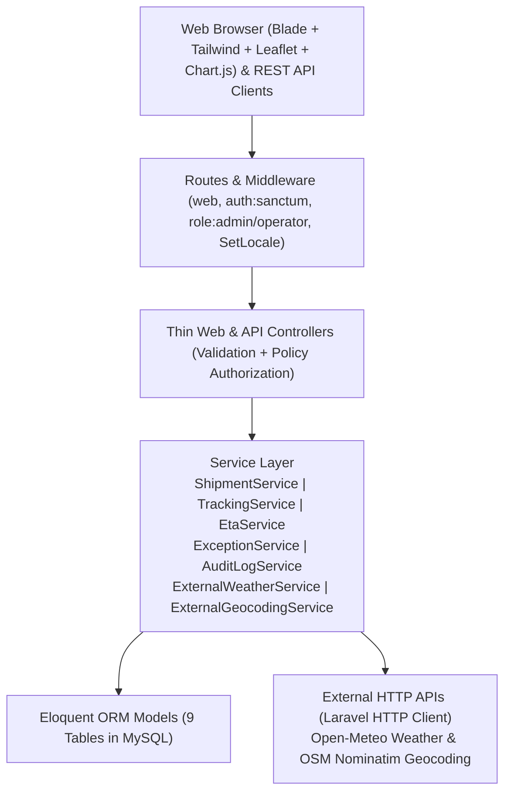
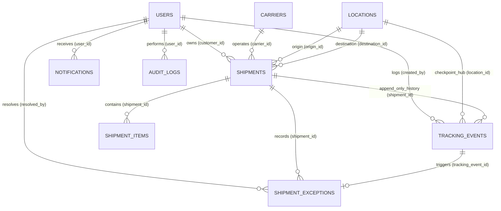

# CargoTrace — Global Automotive & Vehicle Shipment Visibility Platform

[](https://laravel.com)
[](https://php.net)
[](https://mysql.com)
[](https://tailwindcss.com)
[](https://leafletjs.com)
[](https://laravel.com/docs/sanctum)
[](https://cargo-trace-beige.vercel.app/)

**CargoTrace** is a full-stack **Global Shipment Visibility & Tracking Platform** built with **Laravel** and **MySQL**, tailored for cross-border **automotive and vehicle logistics** (CBU Electric Vehicles, luxury cars, premium motorcycles, CKD powertrain kits, and motorsport prototypes) transported via **Ro-Ro car carriers** (*Wallenius Wilhelmsen*, *NYK Line*) and **air freight charters** (*Cargolux*, *Qatar Airways Cargo*) across Southeast Asia &harr; Europe corridors.

> **Live Deployed Application**: [https://cargo-trace-beige.vercel.app/](https://cargo-trace-beige.vercel.app/)
> **Public Tracking Portal**: [https://cargo-trace-beige.vercel.app/tracking](https://cargo-trace-beige.vercel.app/tracking)
> **Health Check Endpoint**: [https://cargo-trace-beige.vercel.app/up](https://cargo-trace-beige.vercel.app/up)
> **REST API Base URL**: `https://cargo-trace-beige.vercel.app/api`

---

## Problem & Solution

### Problem Statement
Cross-border logistics teams and importers frequently face fragmented visibility:
- Shipment records, vehicle manifests (VINs), carrier bookings, and checkpoint updates are scattered across spreadsheets and emails.
- Customers lack a centralized, trustworthy view of current shipment location, chronological journey history, and adjusted ETA.
- Transit delays and exceptions (such as EU homologation / UN3480 lithium battery customs holds or Ro-Ro berth congestion) are not evaluated with consistent rules or surfaced proactively.
- Operations staff lack a live, database-backed dashboard to prioritize open exceptions and monitor SLA compliance.

### Solution
**CargoTrace** centralizes shipment lifecycle management, append-only tracking history, deterministic ETA/delay evaluation, exception workflows, interactive maps, external weather & geocoding services, role-based access control, in-app notifications, audit trails, and a Laravel Sanctum REST API into a single auditable platform.

### Group Scenario Parameters
- **Primary Corridor**: Southeast Asia &harr; Europe (`IDTPP` Jakarta, `THLCH` Laem Chabang, `SGSIN` Singapore, `JPNRT` Tokyo/Narita &harr; `NLRTM` Rotterdam, `BEANR` Antwerp, `DEFRA` Frankfurt)
- **Configurable SLA Delay Threshold**: `DELAY_THRESHOLD_HOURS=12` (configurable via `.env` and `config/cargotrace.php`)
- **Primary Exception Focus**: `CUSTOMS_HOLD` (EU homologation & UN3480 lithium battery verification), alongside `WEATHER_DELAY`, `PORT_CONGESTION`, `DAMAGED`, `MISROUTED`, and `DOCUMENTATION_ISSUE`
- **Primary Operational KPI**: On-Time Delivery Rate, Delay Rate, and Exception Rate

---

## User Roles & Server-Side Permissions (RBAC)

Authorization is enforced strictly on the server via `EnsureUserRole` middleware and Laravel Policies (`ShipmentPolicy`, `UserPolicy`, `CarrierPolicy`, `LocationPolicy`) across both Web and API routes.

| Capability | Administrator | Logistics Operator | Customer |
| :--- | :---: | :---: | :---: |
| Manage Users & Roles (`/users`) | Yes | 403 | 403 |
| Manage Carriers & Hub Locations (Create/Edit/Delete) | Yes | Read-only | Read-only |
| View Governance Audit Logs (`/audit-logs`) | Yes | 403 | 403 |
| Create & Update Shipments | Yes | Yes | 403 |
| Delete (Soft-Delete) Shipments | Yes | 403 | 403 |
| Append Tracking Checkpoints & Advance Status | Yes | Yes | 403 |
| Log, Investigate & Resolve Exceptions | Yes | Yes | 403 |
| View Shipments, Timeline, Route Map & Weather | All | All | Own Only (403 on others) |
| View Dashboard Analytics & In-App Notifications | All | All | Own Only |
| Lookup Hub Coordinates via Geocoding API | Yes | Yes | 403 |

---

## Core Features

- **Finite State Machine Shipment Lifecycle**: Enforces forward transitions (`CREATED` &rarr; `BOOKED` &rarr; `PICKED_UP` &rarr; `IN_TRANSIT` &rarr; `DELIVERED`, plus `CANCELLED` from `CREATED`/`BOOKED`) and blocks reverting terminal states (`DELIVERED`, `CANCELLED`) with HTTP `422`.
- **Append-Only Chronological Tracking & Timeline**: Every checkpoint is preserved historically, validates chronological ordering against the latest event timestamp, distinguishes normal vs. exception events, and derives the shipment's **current location** from the latest valid checkpoint.
- **Deterministic ETA & Delay Severity Engine (`EtaService`)**: Compares `estimated_arrival` against `expected_arrival`, computes `delay_hours`, assigns severity tiers (`0h = NONE`, `0–6h = LOW`, `>6–24h = MEDIUM`, `>24h = HIGH`), checks against the configurable group SLA threshold (`12h`), and surfaces the exact evaluation reason and timestamps in both Web UI and API responses.
- **Exception Management Lifecycle (`ExceptionService`)**: Tracks all 6 exception types through `OPEN` &rarr; `INVESTIGATING` &rarr; `RESOLVED` with `detected_at`, `resolved_at`, `resolved_by`, `delay_impact_hours`, automatic ETA recalculation, customer in-app notifications, and audit logging.
- **Interactive Maps & Dual External APIs**:
  - **Leaflet.js + OpenStreetMap** (default compliant tiles with full attribution, plus Esri World Imagery / World Topo layers, XSS-safe popups, and `tileerror` fallback notices).
  - **Open-Meteo Weather API (`ExternalWeatherService`)**: Informational port/hub meteorological telemetry with timeout, HTTP 5xx, and empty-payload graceful fallback. *(Disclaimer: Weather telemetry is provided strictly as informational context and is not claimed as a delay prediction model.)*
  - **OpenStreetMap Nominatim Geocoding API (`ExternalGeocodingService`)**: Resolves port/city names into GPS coordinates via `GET /api/geocode` and web modals, with explicit `User-Agent`, timeout, error, and empty-result fallback handling.
- **Live Database Dashboard, Search, Filter, Sort & Pagination**: Real-time MySQL KPIs (total shipments, in-transit, delivered, delayed, open exceptions, delay rate, exception rate, on-time rate), Chart.js status/carrier charts, multi-criteria server-side filtering (`search` by shipment # / customer / VIN / model, `status`, `carrier_id`, `origin_id`, `destination_id`, `is_delayed`, `date_from`, `date_to`), server-side sorting (`sort_by`, `sort_dir`), and pagination.
- **Bilingual Interface (`EN` / `ID`)**: Full English and Indonesian UI language toggle persisted in session via `SetLocale` middleware.

---

## System Architecture

Business logic is isolated from HTTP controllers inside dedicated services under `app/Services/`.



---

## Database Design, ERD & Data Dictionary

### Entity Relationship Diagram (9 Core Tables)



### Cardinality & Design Decisions
- **Users `1:N` Shipments**: A customer owns many consignments (`customer_id`), enabling strict server-side tenant scoping via `ShipmentPolicy`.
- **Carriers `1:N` Shipments & Locations `1:N` Shipments (Origin/Destination)**: Foreign keys use `ON DELETE RESTRICT` to prevent orphaned historical consignments when master data is managed.
- **Shipments `1:N` Shipment Items**: Supports multi-vehicle manifests with unique VIN tracking (`vin_number`) per consignment.
- **Shipments `1:N` Tracking Events**: Append-only historical log indexed on `(shipment_id, event_time)` so status updates never overwrite prior milestones.
- **Shipments `1:N` Shipment Exceptions**: Tracks multiple operational incidents per shipment with optional link (`tracking_event_id`) to the exact triggering checkpoint.
- **Soft Deletes**: Applied exclusively to `shipments` (`deleted_at`) so admin deletions preserve referential and audit integrity.

### Data Dictionary

| Table | Key Columns & Types | Constraints / Indexes | Purpose |
| :--- | :--- | :--- | :--- |
| `users` | `id` (PK), `name` (varchar), `email` (varchar), `password` (hashed), `role` (`admin`/`operator`/`customer`), `phone`, `company_name`, `timestamps` | `UNIQUE(email)` | Authenticated platform accounts, RBAC roles, and Sanctum API token owners. |
| `carriers` | `id` (PK), `code` (varchar 20), `name` (varchar 120), `service_type` (varchar 40), `contact_email`, `contact_phone`, `website`, `is_active` (bool), `timestamps` | `UNIQUE(code)` | Ro-Ro sea carriers, air freighters, and road haulers. |
| `locations` | `id` (PK), `code` (varchar 20), `name` (varchar 150), `type` (PORT/AIRPORT/WAREHOUSE/CUSTOMS_FACILITY/HUB), `address`, `city`, `country`, `country_code`, `latitude` (decimal 10,7), `longitude` (decimal 10,7), `timestamps` | `UNIQUE(code)` | Geographic ports, airports, and logistics hubs with coordinates. |
| `shipments` | `id` (PK), `shipment_number` (varchar 50), `customer_id` (FK), `carrier_id` (FK), `origin_id` (FK), `destination_id` (FK), `cargo_type`, `total_weight_kg` (decimal 10,2), `total_volume_cbm` (decimal 10,2), `expected_departure`, `expected_arrival`, `actual_departure`, `actual_arrival`, `estimated_arrival`, `status` (varchar 30), `is_delayed` (bool), `delay_hours` (int), `delay_severity` (NONE/LOW/MEDIUM/HIGH), `notes`, `deleted_at`, `timestamps` | `UNIQUE(shipment_number)`, `INDEX(status)`, `INDEX(is_delayed)`, FKs (`cascade` on user, `restrict` on carrier/locations) | Master consignment record holding lifecycle state and deterministic ETA evaluation fields. |
| `shipment_items` | `id` (PK), `shipment_id` (FK), `item_description` (varchar 200), `vehicle_model` (varchar 150), `vin_number` (varchar 50), `cargo_category` (varchar 40), `quantity` (int), `weight_kg` (decimal 10,2), `declared_value` (decimal 14,2), `dimensions`, `hs_code`, `timestamps` | `UNIQUE(vin_number)`, `INDEX(cargo_category)`, FK `shipment_id` (`cascade`) | Individual vehicle manifest lines, quantities, VINs, values, and customs HS codes. |
| `tracking_events` | `id` (PK), `shipment_id` (FK), `event_type` (varchar 50), `status` (varchar 30), `location_name` (varchar 150), `location_id` (FK nullable), `latitude` (decimal 10,7), `longitude` (decimal 10,7), `event_time` (datetime), `description` (text), `is_exception` (bool), `created_by` (FK nullable), `timestamps` | `INDEX(shipment_id, event_time)`, FKs (`cascade` shipment, `nullOnDelete` location/user) | Append-only chronological checkpoint trail and coordinates. |
| `shipment_exceptions` | `id` (PK), `shipment_id` (FK), `tracking_event_id` (FK nullable), `exception_type` (varchar 50), `severity` (LOW/MEDIUM/HIGH/CRITICAL), `status` (OPEN/INVESTIGATING/RESOLVED), `description` (text), `delay_impact_hours` (int), `detected_at` (datetime), `resolved_at` (datetime nullable), `resolved_by` (FK nullable), `resolution_notes` (text nullable), `timestamps` | `INDEX(status)`, FKs (`cascade` shipment, `nullOnDelete` tracking_event/user) | Operational disruption records, ETA impact hours, and resolution audit metadata. |
| `notifications` | `id` (PK), `user_id` (FK), `title` (varchar), `message` (text), `type` (varchar 50), `link` (varchar nullable), `read_at` (datetime nullable), `timestamps` | `INDEX(user_id, read_at)`, FK `user_id` (`cascade`) | Customer in-app alerts triggered by status transitions and exceptions. |
| `audit_logs` | `id` (PK), `user_id` (FK nullable), `user_name`, `action` (varchar 60), `entity_type` (varchar 60), `entity_id` (bigint nullable), `old_values` (json), `new_values` (json), `ip_address` (varchar 45), `user_agent` (text), `created_at` (timestamp) | `INDEX(entity_type, entity_id)`, `INDEX(action)`, FK `user_id` (`nullOnDelete`) | Governance audit trail capturing actor, action, entity diffs, IP, and timestamp. |

---

## Deterministic Business Rules

### 1. Shipment Status Transitions (`Shipment::TRANSITIONS`)
```text
CREATED ──► BOOKED ──► PICKED_UP ──► IN_TRANSIT ──► DELIVERED (Terminal)
   │           │
   └──► CANCELLED ◄──┘ (Terminal)
```
- Skipping stages (e.g., `CREATED` &rarr; `DELIVERED`) is rejected with HTTP `422`.
- Terminal states (`DELIVERED`, `CANCELLED`) reject any further transition or reversion with HTTP `422`.
- Backdated checkpoints earlier than the latest event timestamp are rejected with HTTP `422`.

### 2. ETA & Delay Severity (`config/cargotrace.php`)
- Configurable group threshold: `DELAY_THRESHOLD_HOURS=12` (default `12` hours).
- `EtaService::explainDelay()` & `evaluateDelay()` compare `estimated_arrival` vs. `expected_arrival`:
  - `0 hours` &rarr; `is_delayed = false`, `delay_severity = NONE`
  - `> 0 to 6 hours` &rarr; `delay_severity = LOW`
  - `> 6 to 24 hours` &rarr; `delay_severity = MEDIUM`
  - `> 24 hours` &rarr; `delay_severity = HIGH`
- Logging an exception with `delay_impact_hours > 0` shifts `estimated_arrival` forward and deterministically re-evaluates severity and SLA compliance.

---

## Local Installation & Setup

### Prerequisites
- **PHP 8.3+** with `pdo_mysql`, `curl`, `mbstring`, `openssl`, `fileinfo`
- **Composer 2.x**
- **MySQL 8.0+** or **MariaDB 10.4+** (e.g., XAMPP / Laragon / Docker)

### Steps
1. **Clone the repository and install dependencies**:
   ```bash
   git clone https://github.com/lidyawulan284-hash/CargoTrace.git
   cd CargoTrace
   composer install
   ```

2. **Create environment file and generate application key**:
   ```bash
   cp .env.example .env
   php artisan key:generate
   ```

3. **Configure `.env`** with your MySQL credentials and business parameters:
   ```ini
   APP_NAME="CargoTrace"
   APP_ENV=local
   APP_DEBUG=true
   APP_URL=http://localhost:8000

   DB_CONNECTION=mysql
   DB_HOST=127.0.0.1
   DB_PORT=3306
   DB_DATABASE=cargotrace
   DB_USERNAME=root
   DB_PASSWORD=

   DELAY_THRESHOLD_HOURS=12
   CARGOTRACE_DEMO_LOGIN_ENABLED=true
   CARGOTRACE_WEATHER_API_URL=https://api.open-meteo.com/v1/forecast
   CARGOTRACE_WEATHER_API_KEY=
   CARGOTRACE_GEOCODING_API_URL=https://nominatim.openstreetmap.org/search
   ```

4. **Create the `cargotrace` MySQL database, run migrations and seed realistic demo data**:
   ```bash
   php artisan migrate:fresh --seed
   ```

5. **Run the local server**:
   ```bash
   php artisan serve
   ```
   Access the application at `http://localhost:8000` (Login / Dashboard) or `http://localhost:8000/tracking` (Public Tracking Portal).

---

## Demo Accounts

All seeded accounts use the password **`password`**. One-click evaluator login buttons are available on the Login and Public Tracking pages (controlled via `CARGOTRACE_DEMO_LOGIN_ENABLED`).

| Role | Email | Password | Access Scope |
| :--- | :--- | :--- | :--- |
| **Administrator** | `admin@cargotrace.test` | `password` | Full access: users & roles, carriers & hub locations CRUD, all shipments, analytics dashboard, and audit logs. |
| **Logistics Operator** | `operator@cargotrace.test` | `password` | Create/update shipments, append tracking checkpoints, flag/investigate/resolve exceptions, geocode lookup. |
| **Customer (EV Importer)** | `customer@cargotrace.test` | `password` | Scoped to own consignments (`CT-2026-RORO-8841`, `CT-2026-RORO-4412`, `CT-2026-RORO-7721`, `CT-2026-RORO-5530`), route maps, and notifications. |
| **Customer (Motorsport)** | `motorsport@cargotrace.test` | `password` | Scoped to own consignments (`CT-2026-AIR-9102`, `CT-2026-AIR-1099`); receives HTTP `403` when requesting another customer's shipment. |

---

## REST API & Postman Collection

Import [`CargoTrace.postman_collection.json`](CargoTrace.postman_collection.json) into Postman. Executing `POST /api/login` automatically stores the Sanctum Bearer token in `{{token}}`. All API errors return consistent JSON (`401`, `403`, `404`, `422`, `500`) without exposing stack traces.

| Method | Endpoint | Description | Authorization |
| :--- | :--- | :--- | :--- |
| `POST` | `/api/register` | Register a customer account & issue Sanctum token | Public |
| `POST` | `/api/login` | Authenticate & acquire Sanctum Bearer token | Public |
| `POST` | `/api/logout` | Revoke active Bearer token | Authenticated |
| `GET` | `/api/user` | Return authenticated user profile | Authenticated |
| `GET` | `/api/public/track/{number}` | Public tracking lookup, current location & delay evaluation | Public |
| `GET` | `/api/shipments` | Filtered, sorted & paginated shipments (`search`, `status`, `carrier_id`, `origin_id`, `destination_id`, `is_delayed`, `date_from`, `date_to`, `sort_by`, `sort_dir`, `per_page`) | Authenticated (role-scoped) |
| `POST` | `/api/shipments` | Create shipment with vehicle items & unique VINs | Admin / Operator |
| `GET` | `/api/shipments/{id}` | Shipment details, delay evaluation, manifest summary & weather | Owner / Admin / Operator |
| `PUT/PATCH` | `/api/shipments/{id}` | Update shipment metadata & recalculate ETA | Admin / Operator |
| `DELETE` | `/api/shipments/{id}` | Soft-delete shipment | Admin Only |
| `GET` | `/api/shipments/{id}/tracking` | Chronological tracking timeline & coordinates | Owner / Admin / Operator |
| `POST` | `/api/shipments/{id}/tracking` | Append validated tracking checkpoint | Admin / Operator |
| `GET` | `/api/shipments/{id}/exceptions` | List shipment exceptions | Owner / Admin / Operator |
| `POST` | `/api/shipments/{id}/exceptions` | Flag exception & adjust ETA | Admin / Operator |
| `PATCH` | `/api/exceptions/{id}` | Transition exception to `INVESTIGATING` or `RESOLVED` | Admin / Operator |
| `GET` | `/api/carriers` | List active carriers | Authenticated |
| `POST` | `/api/carriers` | Register new carrier | Admin Only |
| `GET` | `/api/locations` | List logistics hub locations | Authenticated |
| `POST` | `/api/locations` | Register new location with coordinates | Admin Only |
| `GET` | `/api/geocode?q=...` | Resolve hub coordinates via OpenStreetMap Nominatim | Admin / Operator |

---

## Automated Testing & Test Evidence

Run the full PHPUnit test suite (configured with in-memory SQLite in `phpunit.xml`):

```bash
php artisan test
```

### Verified Test Evidence (`PHPUnit 12.5` on `PHP 8.3`)

```text
Tests:    49 passed (407 assertions)
Duration: ~4.9s
```

| Test Suite | Tests | Key Verified Scenarios |
| :--- | :---: | :--- |
| **`Tests\Feature\AuthenticationTest`** | 16 | Web & API login (valid/invalid), registration, `/api/user`, logout & session invalidation, unauthenticated `401` handling, demo account login, and demo login toggle. |
| **`Tests\Feature\ShipmentApiAndAuthorizationTest`** | 16 | Customer tenant isolation (`403` across Web, API, and telematics endpoints), RBAC enforcement for operators/customers on admin-only resources (`DELETE /api/shipments/{id}`, `POST /api/carriers`, `POST /api/locations`, `/users`, `/audit-logs`), full shipment CRUD (`POST`, `PATCH`, `DELETE`, invalid arrival date `422`), exception API lifecycle (`GET`, `POST`, `PATCH` to `INVESTIGATING`/`RESOLVED`), unique VIN validation, server-side search/filter/sorting/pagination, admin Carrier/Location CRUD with FK-in-use protection, role-protected `/api/geocode`, settings update, and audit log CSV export. |
| **`Tests\Feature\ShipmentLifecycleTest`** | 5 | Full FSM progression (`CREATED` &rarr; `BOOKED` &rarr; `PICKED_UP` &rarr; `IN_TRANSIT` &rarr; `DELIVERED`), rejection of skipped transitions (`422`), terminal status immutability (`DELIVERED` &rarr; `IN_TRANSIT` rejected with `422`), append-only chronological timestamp enforcement, and audit log verification. |
| **`Tests\Feature\EtaDelayEvaluationTest`** | 6 | Deterministic `NONE`/`LOW`/`MEDIUM`/`HIGH` severity tiers, configurable `12h` SLA threshold, `explainDelay()` reason payload, exception lifecycle timestamps & notifications, `ExternalWeatherService` resilience (HTTP 500, empty payload, valid response, timeout), and `ExternalGeocodingService` resilience (HTTP 500, empty payload, valid response, timeout). |
| **`Tests\Feature\LocaleSwitchTest`** | 4 | Session & cookie-persisted English (`en`) & Indonesian (`id`) locale switching, invalid locale rejection, and multi-view translation rendering. |
| **`Tests\Feature\ExampleTest` & `Tests\Unit\ExampleTest`** | 2 | Application boot smoke test and unit test harness sanity check. |

---

## Deployment Guide

**Live Deployment**: [https://cargo-trace-beige.vercel.app/](https://cargo-trace-beige.vercel.app/)

CargoTrace is deployed on **Vercel** (`vercel-php@0.7.4` via `vercel.json` + `api/index.php`) and is also ready for **Laravel Cloud**, **Railway**, **Render**, **Fly.io**, or any **Linux VPS (Nginx + PHP-FPM 8.3 + MySQL 8)**.

### Production Deployment Checklist
1. Set production environment variables in your hosting dashboard (never commit `.env` or `APP_KEY` to Git):
   ```ini
   APP_ENV=production
   APP_DEBUG=false
   APP_URL=https://cargo-trace-beige.vercel.app
   APP_KEY= # generate via php artisan key:generate --show
   DB_CONNECTION=mysql
   DB_HOST= # managed MySQL 8 host (e.g., Aiven / TiDB Cloud / Railway)
   DB_PORT=3306
   DB_DATABASE=cargotrace
   DB_USERNAME=
   DB_PASSWORD=
   DELAY_THRESHOLD_HOURS=12
   CARGOTRACE_DEMO_LOGIN_ENABLED=true # set false for non-demo production
   ```
2. Install production PHP dependencies and run database migrations & seeders:
   ```bash
   composer install --no-dev --optimize-autoloader
   php artisan migrate --force
   php artisan db:seed --force   # only for demo/portfolio showcase environments
   php artisan config:cache
   php artisan route:cache
   php artisan view:cache
   ```
3. Verify health endpoint: `GET /up` returns HTTP `200` (`{"status":"up"}`).

---

## Known Limitations & Future Work

### Known Limitations
- **Synthetic Operational Data**: Carrier schedules, VIN manifests, and tracking checkpoints are synthetic demonstration data rather than live carrier EDI/AIS/ADS-B feeds.
- **Serverless Demo Storage Note**: On Vercel serverless deployments without an external managed MySQL instance configured (`DB_HOST`/`DB_URL`), the demo fallback copies a pre-seeded SQLite snapshot into ephemeral `/tmp` storage; connecting a managed MySQL 8 database is recommended for cross-invocation persistence in production.
- **In-App Notifications Only**: Notifications are persisted in the database and displayed in the in-app notification center; outbound SMTP email/webhook delivery is not enabled by default (`MAIL_MAILER=log`).
- **Rate Limits on Public Free Tile & Geocoding Providers**: OpenStreetMap tiles and Nominatim enforce fair-use rate limits; heavy production traffic requires a dedicated tile server or commercial geocoding API key.
- **No Automated Delay Prediction**: Weather telemetry is displayed solely for operator awareness and does not automatically compute predictive arrival delays.

### Future Work
- Queue-backed email & webhook notifications (Laravel Queues + Mailables) on critical delays and customs holds.
- CSV / PDF Bill of Lading & VIN manifest export per shipment.
- Multi-hop sea-route maritime polylines and AIS vessel position webhooks.
- Containerized Docker Compose setup and automated GitHub Actions CI/CD pipeline.

---

## Third-Party Libraries, Services & Attribution

In accordance with open-source licensing and academic attribution standards, CargoTrace builds on the following external frameworks, libraries, and public data services:

- **Laravel Framework (`laravel/framework`) & Laravel Sanctum (`laravel/sanctum`)** — MIT License, © Taylor Otwell & Laravel Contributors ([laravel.com](https://laravel.com)).
- **Tailwind CSS** — MIT License, © Tailwind Labs ([tailwindcss.com](https://tailwindcss.com)).
- **Lucide Icons** — ISC License, © Lucide Contributors ([lucide.dev](https://lucide.dev)).
- **Leaflet.js** — BSD-2-Clause License, © Volodymyr Agafonkin ([leafletjs.com](https://leafletjs.com)).
- **Map Data & Tiles**:
  - **OpenStreetMap** — Data © [OpenStreetMap contributors](https://www.openstreetmap.org/copyright), available under ODbL.
  - **Esri World Imagery & World Topographic Map** — Tiles © Esri (used with explicit attribution on optional Satellite/Terrain layers).
- **Chart.js** — MIT License, © Chart.js Contributors ([chartjs.org](https://www.chartjs.org)).
- **Open-Meteo Weather API** — Free non-commercial weather telemetry API ([open-meteo.com](https://open-meteo.com)).
- **OpenStreetMap Nominatim** — Open-source geocoding service ([nominatim.org](https://nominatim.org)), queried with explicit `User-Agent` and bounded timeouts.
- **Plus Jakarta Sans & Inter** — SIL Open Font License, loaded via Google Fonts.
- **PHPUnit & Laravel Pint** — Automated testing and PSR-12 / Laravel code style enforcement.
